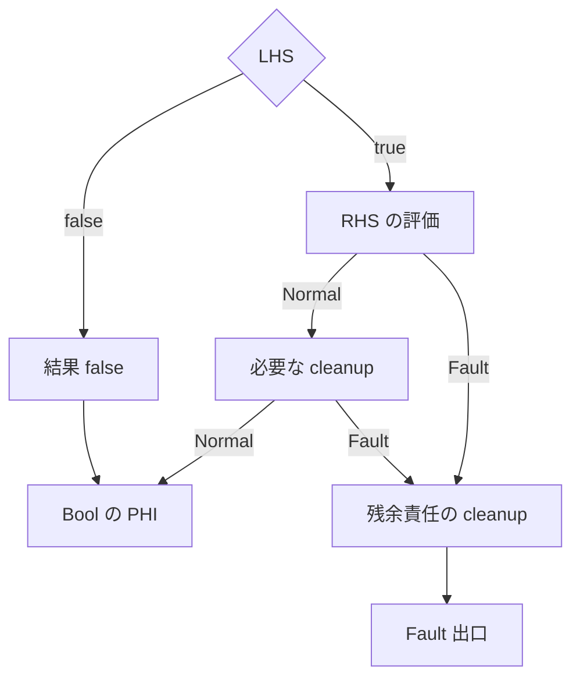

# S3b の設計の相談(所有の状態と Fault の後片付けを CFG の解析へ移す)

Exception: 外部 AI の回答は再生成できないので残します(RULES §7「`/tmp` だけを永続証拠にしない」)。

ParentCurrentCard: `docs/development/current/main/investigations/app-boxtorrent-mini.md`

Status: 相談の文と回答の記録です。authority ではありません。順番の正本は[整理の順番](mirbuilder-structure-refactor-queue-d0-2026-08-23.md)です。

## 相談の文(2026-11-07、ChatGPT Pro へ。下の線から最後までを貼る)

---

自作言語 Hakorune のコンパイラについて、独立した意見をください。所有の状態と Fault の後片付けを、「source の意図を保持した CFG の上の解析」へ移す最初の段階(S3b)の作り方です。結論を誰かに合わせる必要はありません。下の案より良い作りがあれば、それを勧めてください。

リポジトリは github.com/hakorune/hakorune の main、commit `ec9cd19681` です。根拠は file:line で示してください。読んで確かめられなかったことは、その旨を書いてください。私の前提が間違っていたら、先に指摘してください。

## 背景

- Box 中心の言語で、GC はなく、所有は明示します(`move`、`share`、`take`、`from` など)。文法は ADR-002 で凍結済みです(`docs/development/adr/adr-002-explicit-ownership-and-compiler-migration.md`)。ADR-002 の 73 行目には「同一の semantic CFG で ownership・borrow を解析」とあります。
- 流れ: source → parser → resolver → 意味の package(`src/mir/normal_callable_semantic_package`、`src/mir/resolved_semantics`)→ MIR builder(`src/mir/builder`)→ 生成後の独立検証 → 物理 ABI の JSON → C shim → LLVM → EXE。
- 守る物:
  - すべての呼び出しと演算で、Normal と Fault の両方の End(後始末)の責任を閉じます。不変条件は「その関数の責任を、End か正当な移転で一度だけ閉じる」です。
  - 生成後の独立検証は弱めません。
  - 形ごとの専用 producer、silent fallback、AST の書き換えは使いません。
  - 公開 MIR、opcode、ABI、descriptor の追加はメンテナが決めます。
- 進め方: 稼働中のコンパイラを責務ごとに入れ替えます。並行の別コンパイラは作りません(`docs/development/current/main/design/mirbuilder-inplace-replacement-policy-ssot.md`)。

## これまでに決めた事

- 2026-11-06 の相談(経路の選び方)で、目標の流れを決めました。記録は `docs/development/current/main/investigations/mirbuilder-route-selection-survey-2026-11-06.md` と、`docs/development/current/main/investigations/mirbuilder-structure-refactor-queue-d0-2026-08-23.md` の節「流れの作り直し」です。流れは次の 5 つです。
  1. 型と宣言の契約を確定する。
  2. source の意図を保持した、未公開の関数の CFG を作る。保持する物は、明示の move/share/take/copy、Binding・Place・source site、スコープ、cleanup の登録順、評価順、commit の契約です。
  3. その CFG の上の dataflow(loop は不動点)で、使える binding、生きた所有の責任・移転待ち・移転済み、借用、各 Normal/Fault 辺の End を求める。End は既存の cleanup の部品で具体化する。
  4. cleanup の Fault 辺まで含めて、既存の CFG と PHI の持ち主(`CanonicalCfgSessionV1`、`PhiTxn`)で確定する。seal を先に閉じない。
  5. source との対応の検査と、公開 MIR の独立検証。独立の verifier を End の生成器と兼ねない。
- 段階 S3 の完了の条件は、「新しい使い先をつないだ時に、新しい分類器と cleanup の持ち主が増えない」です。
  - S3a(値の種類の規則を 1 つ、演算子の表を 1 つ)は着地しました。
  - S3b は「呼び出しと分岐の所有の状態と Fault の cleanup を、意図を保持した CFG の解析へ移す、最初の責務を 1 つ」です。
- 結果の契約の相談(`docs/development/current/main/investigations/result-contract-consult-2026-11-06.md` の回答の 4)の決定: 結果の契約は責任の種類を決め、S3b の CFG の解析は責任が移る時点を決めます。S3b は結果の型を推論し直しません。
  - 結果の契約のうち Unit、I64、Bool は着地しました(`docs/development/current/main/investigations/mirbuilder-result-contract-bool-2026-11-07.md`)。
- S3b の後は、所有の String・object・nullable の結果、S4(loop を共有の CFG と `PhiTxn` に寄せる)、`edit`、3b(旧経路の退役)の順です。

## 今の作り(私が読んだ範囲)

- 所有の状態は、source の上の線形な走査 `scan_new_home_flow`(`src/mir/resolved_semantics/home_new_prefix.rs:377`)の中で、形ごとの観測が持っています。走査は、前の文の結果(生きた Home、move 済み、失敗)を読みます。
- 「元の名前は使えないが、呼んだ側にまだ終了の責任がある」状態は `StoredLocal::MovedOut` です(`src/mir/resolved_semantics/home_call_entry_transfer.rs:14`)。
- 分岐ごとの状態の解析は `src/mir/resolved_semantics/home_new_prefix_branch.rs` にあります(783 行。`walk_branch` は 33 行目、`observe_if_statement` は 235 行目)。
- `CanonicalCfgSessionV1`(`src/mir/builder/resolved_lowering/canonical_cfg/session.rs`)は seal した block を持ちます。seal の後で predecessor が変わった時は拒否します(396 行目の `SealedPredecessorsChanged`、406 行目の `SealedBlockRemoved`)。`PhiTxn` は `src/mir/builder/emission/phi_lifecycle.rs:133` です。
- `&&` と `||`:
  - 条件の位置では、短絡の分岐として書かれます(`src/mir/normal_callable_semantic_package/ordinary_new_local_commit/root_call_entry/bool_condition_control.rs`)。
  - 値の位置(`return x > 1 && y < 3`)には、値を書く writer がありません。`static-execution/completion-not-ready`(`src/mir/normal_callable_semantic_package/direct_call_static_execution.rs:98`)で拒否されます。
  - 意味は仕様で短絡と決まっています(`docs/reference/language/EBNF.md` の Notes の「Short-circuit」と、C197 の行)。
- 凍結した文法が受け付ける所有の形 129 個のうち、EXE までつながるのは 34 個です(`docs/reference/language/status-index.md` の 94 行目)。

## 聞きたいこと

1. **最初に移す責務を 1 つ選んでください。** 私の候補は次の 3 つです。
   - (a) 1 つの呼び出しの前後で、取得済みの一時値の Fault の後片付け
   - (b) `if`/`else` の合流での所有の状態
   - (c) 値の位置の `&&` `||`

   どれなら「解析の土台」を最も小さく作れて、後の段階(所有の String・object・nullable の結果、S4 の loop、`edit`)が同じ土台に乗れますか。完了の条件と、同じ series で消せる旧い判定も挙げてください。
2. **意図を保持した未公開の CFG の最小の形を勧めてください。** node と辺、各地点に持たせる物、Fault の辺の表し方、cleanup の登録順と評価順の持ち方です。今の `CanonicalCfgSessionV1` と `PhiTxn` に、どこで、どの順で渡せば、「seal を先に閉じない」を守れますか。
3. **dataflow の状態の領域と、合流の規則を勧めてください。** 状態は、生きた責任、移転待ち、移転済みで caller に責任が残る物、借用、消費済みです。片方の枝だけで move した時は、拒否、drop flag、合流での End のどれにすべきですか。ADR-002 や仕様の文書に決まりが既にあれば、その場所を示してください。
4. **3 つの線をどこで引くか教えてください。** End を決める所(dataflow)、End を具体化する所(既存の cleanup の部品)、独立検証です。今の形ごとの cleanup のうち、そのまま部品として使える物と、作り直す物を、コードを読んで分けてください。
5. **移行の間の範囲の切り方を勧めてください。** 線形の走査 `scan_new_home_flow` と新しい解析が、同じ関数の中で重ならないようにしたいです(関数単位、文の種類単位など)。両方を試す fallback は使いません。最初の series で、既存の受理を 1 つも落とさずに済む切り方はありますか。
6. **値の位置の `&&` `||` の作り方を勧めてください。** 分岐と合流(Phi)で書くとします。右辺の呼び出しが一時値を取得したり Fault したりする時、End を実際に評価した道だけで閉じる方法を知りたいです。条件の位置と値の位置で、writer を 1 つにすべきですか。
7. **S3b の効果を測る物差しを勧めてください。** 「新しい使い先をつないだ時に、新しい分類器と cleanup の持ち主が増えない」を、series の終わりに数で示したいです。何を数えればよいですか。

## 回答(2026-11-07、ChatGPT Pro。ユーザーが貼った原文から。前提の訂正、表、完了の条件、図はそのまま。説明の段落は Opus が短くまとめた)

指定された **`ec9cd196813e58f53a91f67378f41a57cb3b4e23`** を読みました。コード変更、ビルド、EXE の再実行はしていません。以下の「確認済み」は、この commit のコード・仕様を読んで確認したことです。設計上の勧めとは分けて書きます。

### 先に、前提を4点補正します

#### 1. `MovedOut` だけでは「caller に終了責任が残る」とは決まりません

必要としている状態そのものは正しいです。ただし、現在の `StoredLocal::MovedOut` は、それを単独で表していません。

- ローカル間の move では、Home を元の cleanup 順位のまま別 binding に付け替え、元 binding を `MovedOut` にします。
- call-entry の take 移転でも `MovedOut` にしますが、こちらでは caller の `homes` から対象を除きます。

つまり、現在も実際には **binding の可用性と、別に持っている Home の集合との組み合わせ**で意味が決まります。新しい解析でも、この二つを分離する必要があります。
根拠：home_call_entry_transfer.rs:57、同:176。

#### 2. 値を返す短絡 writer は、リポジトリには既にあります

`build_logical_shortcircuit_after_lhs_v1` は `ValueId` を返し、その内部では skip・RHS true・RHS false の3経路を PHI でまとめ、結果を Bool にしています。

したがって、正確には **「今回の意味 package と lifecycle の認定を通る値評価経路に、短絡の意味解析・cleanup・結果の受け渡しが接続されていない」**です。

また、ご提示の `bool_condition_control.rs` は writer そのものではなく、生成された短絡 CFG と PHI の対応を確かめる validator です。
根拠：logical_shortcircuit.rs:119、同:267、bool_condition_control.rs:8。

#### 3. live/empty 合流での drop flag は、既に採用方向が書かれています

ADR-002 の「再代入と失敗」には、**live/empty が実際に合流する場合にだけ drop flag を使い、PHI は `PhiTxn` が発行する**とあります。「コンパイラの責務」にも同じ方向が書かれています。

一方、現在の source 側の分岐解析は、両枝の Home 状態が一致しないと `HomeFlowBranchDivergent` にします。これは現在の実装範囲であり、片枝 move を言語として永久に拒否する決定ではありません。
根拠：ADR-002:62、同:84、home_new_prefix_branch.rs:686。

#### 4. 34/129 は、この commit で測り直した数字ではありません

`status-index.md` は、測定を **2026-11-05、commit `c1739a89c2`** と明記しています。34/129 はその測定記録です。今回の設計判断の背景には使えますが、S3b の開始時点の実測 baseline としては再取得が必要です。
根拠：status-index.md:90。

### 1. 最初に移す責務は、(a) を勧めます

ただし、責務の定義を次のようにします。

> **呼び出しの評価フレームについて、取得済みの責任を、引数評価・call-entry・Call Normal/Fault・引数 cleanup の Fault まで追い、各辺の End 計画を一つの解析から出す。**

「Call の Fault landing に End を付ける」だけでは狭すぎます。Call が成功したあと、引数の後片付けが Fault する経路まで含めて初めて、責任が閉じます。

| 候補 | 最初に必要になる仕組み | 私の判断 |
|---|---|---|
| **(a) 呼び出し前後の一時責任と Fault cleanup** | 取得、評価順、移転待ち、commit、Normal/Fault、End の残余列 | **最初に選ぶ。後続すべてに必要な遷移を、小さい CFG で実証できる** |
| (b) `if`/`else` の所有合流 | 上記に加えて、条件付き責任、binding の可用性の合流、borrow の支持関係、drop flag | 土台の次。最初から選ぶと、生成側と独立 verifier の両方を広げる必要がある |
| (c) 値の `&&` / `||` | 条件付き評価、Bool の合流、経路ごとの一時責任 | **土台の再利用を試す使い先に適する**。単独では、未受理形の追加だけで終わる危険がある |

最初の対応範囲: 既に契約が確定している呼び出しと演算。local、局所 move、既存の通常 take 入場。既存契約で生まれる Text などの一時値。関数の結果は、まず Unit/I64/Bool。explicit return と implicit exit。source の `if`、loop、値の短絡、`edit`、所有を変える複雑な置換は、最初の対応語彙に含めない。**source が直線的でも、解析対象は CFG です。** 途中の取得が失敗する辺、callee に入った後の Fault、End 自身の Fault があるからです。ここで作るのは、特定の呼び出し形専用の producer ではありません。確定した操作契約を順序どおりに置き、その効果を解析する仕組みです。呼び出しの個数や入れ子の深さを固定した template にしないことが大切です。

最初の series の完了条件:
1. **選択した関数の所有解析が、新解析一つになる。**
2. 入場前 Fault、入場後 Fault、Normal cleanup 中の Fault で、責任の所在と End 順序が正しい。
3. 下流の emitter は、解析済みの End 計画を受け取り、取得済み値の一覧から再計算しない。
4. cleanup の Fault 辺まで作ってから CFG/PHI を確定する。
5. **二つ目の既存の使い先をつないでも、所有遷移の判定者と cleanup の計画者が増えない。**
6. 移した範囲の旧判断への到達がゼロになり、専有コードを同じ series で削除する。

### 2. 未公開 CFG は「既存の source product＋操作の責任遷移」にする

source の木を作り直す必要はありません。`ExpressionSourceNodeV1`(source site、元の式、子との関係)、`ExpressionSourcePlanV1`(関数 owner、式の root、node 群)、`ExpressionChildReachV1`(常に評価する子と、条件付きで評価する子。`&&` の RHS は `When(lhs, true)`、`||` の RHS は `When(lhs, false)`)が既にあります。この到達性を再び別の And/Or 分類器で決める必要はありません。根拠：expression_plan.rs:108、expression_children.rs:10、同:90。

勧める最小構造(新しい内部表現の設計案。型名や公開命令の追加提案ではない):

| 部分 | 持たせる物 |
|---|---|
| 関数 | 既存の owner、確定済み契約への参照、entry、Normal/Fault exit |
| block | 論理 block ID、scope、順序付き操作列、terminator |
| 操作 | source site、既存の型・callee・演算契約への参照、入力・結果、Binding/Place、明示された所有操作 |
| 責任への効果 | 取得、binding の無効化、移転待ち、commit、借用開始・終了、cleanup 登録 |
| terminator | `Goto`、`Branch`、Fault 可能な操作の `Normal/Fault`、関数の出口 |
| cleanup 登録 | 責任 ID、scope または評価フレーム、登録位置・順序、既存の型別 End 契約 |
| 解析結果 | 地点・辺ごとの状態、順序付き End 計画、元 source への対応 |

**確定済みの情報と、解析で求める情報を混ぜない。** call node が持つのは「この引数は take」「結果はこの契約」「移転の commit は call-entry」という事実で、「この時点で Home が生きている」という答えは dataflow 側に置く。CFG 本体は不変の操作・辺を持ち、状態は node/edge ID をキーにした解析結果として別に持てる。

Fault は操作ごとの明示的な辺にする。Fault 可能な操作は必ず Normal と Fault の後継を持つ。型が Bool や I64 だから Fault しない、とは判断しない(操作契約から読む)。取得する操作は Normal でだけ結果の責任が生まれる。通常 take 呼び出しは call-entry で移転し、その後は Normal/Fault 両方で caller から外れる(`entered_prior_homes_v1`、call_packet_source.rs:569)。End はその責任を試行済みとし、どちらでも再試行しない。返却は cleanup が成功するまで pending result を保護し、成功した出口で移転する。

評価順と cleanup 順序は別の情報。評価順は block 内の操作順と CFG の辺で表し、引数 ordinal と source site は対応の検査のために残す。cleanup 順序は責任を登録した scope/frame と元の順位で表す。理由: `move x` は新しい cleanup 順位を作らず元の Home の順位を保持する。lexical cleanup と local Home の End には仕様上の順序がある。Call Normal で取得した結果でも、引数 cleanup が終わるまで保護される場合がある(今の String の検証器は、Call の結果をその呼び出し自身の引数 cleanup suffix の下に保持し、引数 End が Fault したら結果を cancellation し、引数 cleanup 前の結果使用を拒否する)。取得時刻だけをキーにした一律 LIFO では現行契約を保存できない。根拠：scope-exit-semantics.md:75、invoke_string_lifetime.rs:750、invoke_string.rs:321。最初の表現には、少なくとも「通常の評価一時値」「元の local Home」「cleanup 完了待ちの結果」を区別できる登録先・段階を持たせる。

CanonicalCfgSession / PhiTxn へ渡す順序: (1) source の意図 CFG を作る (2) ownership/borrow dataflow で各辺の責任を求める (3) End の対象と順序、各 End が Fault した場合の残余列を決める (4) 既存 cleanup 部品で、End 自身の Fault 辺を含む物理 CFG を展開する (5) 全 predecessor が出そろってから `CanonicalCfgSessionV1::seal_block` (6) その witness と実際の predecessor で SSA/PHI の入力を確定する (7) 既存の function close と `PhiTxn::commit` (8) source 対応検査、独立検証、公開。最初の series では、選択した関数の topology が完成するまで block seal を遅らせる。provisional PHI の定義まで遅らせる必要はない。根拠：canonical_cfg/session.rs:337、同:419、phi_lifecycle.rs:151、draft_seal_close.rs:51。

### 3. dataflow は、一つの巨大な所有 enum にしない

| 軸 | 状態・情報 |
|---|---|
| **Binding/Place の可用性** | 未初期化、利用可能、move 済み、経路によって利用可能性が異なる |
| **責任の存在と所在地** | 未取得、caller に存在、callee/field/返却先へ移転済み、End 試行済み |
| **移転段階** | 通常保持、特定の call/格納への移転待ち、commit 済み |
| **借用** | loan ID、read/edit、支持する Home/Place、projection・version、有効区間 |
| **終了処理** | 通常の処理中、Normal 結果を保護中、Fault 処理中、未試行 cleanup の列 |

「元の名前からは move 済みだが、caller に終了責任が残る」は `binding = 使用不可` ＋ `責任 = caller に存在` ＋ `段階 = 移転待ち` で表す。責任 ID は binding 名から独立させ、alias や付け替えでも元の責任を追跡する。

| 地点 | 元 binding | caller の責任 |
|---|---|---|
| `move x` の前 | 使用可能 | 元 Home を持つ |
| `move x` 評価後、entry 前 | 使用不可 | 元 Home・元順位のまま保持 |
| 後の引数が Fault | 使用不可のまま | 取得済み一時値と元 Home を cleanup |
| call-entry に到達 | 使用不可 | take 対象を一括で除く |
| callee が Fault | 使用不可 | take 対象を再 End しない。caller に残る一時値などだけ cleanup |
| Call Normal | 使用不可 | 結果契約に応じて、新しい結果の責任を受領 |

`move` のあとに Fault したから binding を復活させる rollback は入れない(ADR-002:62)。

合流規則: 到達しない辺は合流に含めない。binding の使用は、到達する全経路で利用可能な場合だけ許す。cleanup 責任は片方にしか存在しなくても捨てない。loan は片方の経路にあるだけで競合検査から消さない。異なる incoming の責任 ID・支持元はその対応を保持する。同じ型であることを同じ所有責任であることの代わりにしない。責任ごとに「あり得る状態の集合」を持ち合流を union にする有限領域が一案。ただし union だけでは物理 End は発行できないので、どの incoming で責任が存在するかを保持し、必要な場合に flag と対応させる。

片枝だけ move した場合(説明の例。受理済みとは主張しない):

```hako
local x = make()
if cond {
    consume(move x)
}
work()
```

| 状況 | 扱い |
|---|---|
| 合流後に `x` を読み、move し、借用する | 全経路で使える証明がないので拒否 |
| 合流後に `x` を使わないが、片側に責任が残る | 実際の終了点まで条件付き責任を保持し、必要な drop flag を使う |
| その辺で本当に `x` の scope を抜ける | その scope exit の End を置く |
| 状態を揃える目的だけで、合流直前に外側の `x` を End | 原則採らない |

ただし、初回 S3b で drop flag の一般受理を開くべきではない。今の独立所有 verifier は successor に届く状態が既存状態と違うと `LiveSetMismatch` で拒否し、Shared の所有 PHI も最初の対応範囲は同じ token の rename に限られる。Bool の flag PHI を足せば独立検証も通る、とは言えない。根拠：ownership_ssa/verify.rs:284、同:600。初回はそのような関数を初めから残余側へ分類し、現行の受理・拒否を保つ。

loop に向けて: 実行回数ごとに新しい Home ID を増やす表現を避ける。静的な取得地点・Place と loop に持ち越す責任の version の関係を使い、有限領域上で不動点を求める。backedge では「前周の責任を閉じ、次周の責任が一つ届く」ことを確認する。

### 4. End の決定・具体化・検証の線引き

| 層 | 決めること | 入力にしてはいけない判断 |
|---|---|---|
| **CFG dataflow / End planner** | どの責任が残るか、誰へ移ったか、どの辺で何をどの順に End するか | 物理 emitter がたまたま記録した値の一覧からの再推論 |
| **cleanup materializer** | 決定済み End を既存の型別 operation・landing・suffix CFG にする | source の形を見て End 対象を追加・削除する判断 |
| **検証** | source 対応と、生成物上の型・所有・借用・実 CFG の整合 | 生成側の解析結果を「検証済みだから正しい」と受け入れること |

再利用できる部品: `emit_cleanup_suffixes_with_writer` / `emit_cleanup_actions_to_fault_with_writer`(再利用)、`cleanup_step_with_writer`(再利用)、`CanonicalRootGraphWriterV1`(再利用・一般化)、`source_home_end_plans_v1`(型別 End への投影部品として再利用候補。対象集合と順序は新解析が渡す)、`fault_indices_after_normal_step_v2`(再利用)、construction の `emit_discharge`(後続でも再利用候補。block 発行は同じ CFG owner に通す)。根拠：root_graph.rs:148、同:222、同:325、static_loop_root_graph_writer.rs:9、root_home_cleanup_order.rs:104、同:188、fault_cleanup.rs:8。canonical adapter が全 operation に対応済みという意味ではない(`emit_root_invoke` には operation の制限がある。canonical_cfg/session/invoke.rs:26)。

初回 series で、移行対象関数について撤去する旧い生成判断:

| 現在の判断 | 移し先 |
|---|---|
| `validate_pending_call_uses_v1` による locals の clone と評価順シミュレーション | CFG 上の use と move の遷移 |
| `commit_statement_takes_v1` による文単位の take 更新 | 正確な call-entry の遷移 |
| `pending_operations` による物理一時値一覧からの End 列生成 | 辺ごとの End 計画 |
| `deferred_argument_ends_v1` による引数 packet 巡回・逆順化 | 解析済みの評価フレーム cleanup |
| lexical call の pre-entry / entered unwind の組み立て | commit 前後の辺状態から得る計画 |

根拠：home_call_entry_transfer.rs:66、同:137、expression_value/cleanup.rs:4、lexical_argument_projection.rs:1085、lexical_i64.rs:222。`prepare_operation_cleanup_v1` は丸ごと捨てない(選ばれた操作列の結合、重複検査、suffix の組み立ては再利用できる。移すのは何が生きているかを選ぶ入力側)。同関数の「Call 自体の Fault では結果はまだ存在しないが、Call Normal 後の cleanup Fault では結果の cancellation が必要」という区別は必ず残す(root_graph.rs:481、同:504)。Bool 条件専用の一時値判断は、条件・短絡を移す段階の撤去対象(expression_value/cleanup.rs:36)。

独立検証と source 対応検査は両方残す。source 対応検査は、物理命令とその packet が一緒に消えても元 source から欠落を見つける(finalized_initializer_homes.rs:13)。独立側は実 terminator から predecessor を計算し、Normal landing の専有性や Fault 経路での結果使用を検査する(verification/invoke.rs:355、同:472、同:496)。`published_homes.rs` の `OutsideModel` を「独立に検証できた」と数えない(published_homes.rs:20、同:85)。

### 5. 移行の境界は、関数単位を勧めます

一文単位で新旧の所有解析を混ぜる切り方は勧めない。既存 package の内部で次を一度だけ決める:

```text
関数が要求する操作・契約が、移行済みの対応範囲にすべて含まれる
    → 新しい CFG 解析
対応範囲外の操作・契約を含む
    → 既存の解析
新しい CFG 解析が所有エラーを検出
    → そのエラーで終了
```

新側への判定に、特定の関数名、fixture、一連の AST の完全一致を使わない。対応できる操作・契約の集合で、一つの関数の解析担当を決める(inplace-replacement-policy:356、同:369)。

切り替える場所は主 scan の直前だけでは足りない。主経路の completion 呼び出し(ordinary_new_coseal_issue.rs:535)とその先の `scan_new_home_flow`(function_control_new_homes.rs:142)の前に、readiness probe(:338)、borrowed source 用 probe(:457)、sibling 走査(:714、:726)がある。担当の決定は :338 の probe より前に置く。新側では解析結果を一度保持し、readiness、引数 prefix、出口、cleanup への問い合わせをそこから投影する。adapter の内部で旧 scan を呼んだり、旧い形分類を再実行したりしない。

「最初の series で既存受理を一つも落とさない」は、対応範囲外の関数を初めから既存側に残す方式なら可能。ただし今回の読解だけで無退行は保証できない。一つの Call の cleanup だけを直すより、選択した関数の entry・local・全 Call・exit の情報を新解析から出す方が大きいが、この負担で新旧の状態を往復させずに済む。共有 helper は残余関数が使う限り残す。選択した旧 edge がゼロであることと helper 全体の caller-zero は別の条件(inplace-replacement-policy:255)。

### 6. 値の `&&` / `||` は、同じ CFG 構築と解析を使う

短絡の評価順・到達性・所有解析の作り手は一つにする。条件位置は true/false の行き先へ、値位置は正常な結果経路を Bool の PHI へ接続する。最初は Bool 値を PHI で作ってから条件分岐に使ってもよい。



skip 経路には RHS の取得 event がない。RHS の取得が Fault した場合その結果の責任は生まれない。RHS の途中で後続操作が Fault した場合、それまでに取得した責任だけを閉じる。RHS 内の take が commit 済みなら caller は再 End しない。End 自身が Fault したら残りを閉じて Fault 出口へ進む。Fault を Bool の false として PHI に入れない。短絡の合流点だからという理由で一時値の寿命を早めない。PHI の incoming key は、cleanup 後に実際に合流へ Jump する最後の Normal block を使う。既存 `logical_shortcircuit.rs` は `variable_map` の snapshot、`update_cfg`、`builder.insert_phi`、変数の merge を持つので、新しい CFG/SSA owner の横で動かさない(同:185、同:273)。値位置の今の制約は emitter だけではない。共通の値評価へ回った Bool root は比較 operation として資格が取れた場合だけ認められる(home_print_expression.rs:209、direct_call_lifecycle.rs:348)。`completion-not-ready` を緩める修正では短絡の責務は閉じない。

### 7. S3b の効果は「判断者の数」と「再利用時の差分」で測る

| 指標 | series 終了時の目標 |
|---|---:|
| 移行対象関数ごとの解析担当 | 1 |
| 同関数での新解析実行回数 | 1(不動点の反復回数とは別) |
| 同関数での旧 `scan_new_home_flow` 実行回数 | 0(probe を含む) |
| 同関数で End 対象・順序を決める owner | 1 |
| emitter 内の live inventory 再計算 | 0 |
| 新解析失敗後の旧側再試行 | 0 |
| 選択した旧 production edge | 0 |
| 新 owner を使う実 production caller | 1以上 |
| cleanup 展開後の predecessor 不整合 | 0 |
| 対象となる既存受理の脱落 | 0 |
| source 対応・独立検証の意図しない迂回 | 0 |

最初の consumer が通ったあと、同じ操作契約を二つ目の既存 consumer に接続し、その差分で「値の意味を決め直す分類器」「所有状態の遷移を決める別実装」「cleanup 対象・順序を決める owner」「source の形専用 producer」が +0 であることを数える。結果の受け取り方を接続する adapter の追加は直ちに失敗ではない。問題は adapter が「この形では何が生きているか」を再判断し始めること。

静的 baseline の例: `selected/expression_value/cleanup.rs` の `pending_operations` は production で 3 ファイル・11 呼び出し箇所(expression_value.rs 6、expression_value/cleanup.rs 3、print_expression.rs 2)。これは呼び出し箇所数で、owner の数や実行回数ではない。

最初の series で確かめる意味: 最初の取得が Fault(未取得の値を End しない)、一時値 A 取得後に B の取得が Fault(A だけ閉じる)、`move x` 後に次引数が Fault(binding は復活せず caller が元責任を閉じる)、entry 後に callee が Fault(take 対象を再 End しない)、read 引数の一時値を持つ callee が Fault(caller に残った一時責任を閉じる)、Call Normal 後の引数 End が Fault(未試行の引数 cleanup、必要な結果 cancellation、残った Home を契約順で閉じる)、cleanup がさらに Fault(最初の Fault を保持し、残りを続行し、試行済み End は再実行しない)、MIR の End 欠落・二重化・辺取り違え(対応する検証が拒否する)。既存の `ownership_take_entry` smoke(`consume(move p, me.later())`、canonical_app_exe_cases.sh)と、Fault release の欠落や End の再試行を拒否する既存テスト(root_cleanup_order_path_tests.rs:255、同:281)を素材にし、検出力を保ったまま移す。

**最初の S3b series の成果物は、「対応範囲を明示した関数群について、呼び出し評価の責任と全 Fault cleanup を一度の CFG 解析から発行し、既存 cleanup 部品・canonical CFG/PHI・既存検証へ接続し、その関数群から旧状態走査と旧 cleanup 再計算を外すこと」。** 値の短絡や片枝 move の一般受理まで完成させる必要はない。ただし次にそれらを接続するときに、同じ取得・移転・借用・End の遷移を使えることを設計条件にする。

(原文の GitHub への link は、file:line の表記に直した。)

## Opus の確認(2026-11-07、main `0e6b0948c2` で読んだ。実行はしていない)

- 前提の訂正 4 点は、どれも合っていた。
  - `MovedOut` は 2 つの意味で使われている。local の move は Home を別の binding に付け替える(`home_call_entry_transfer.rs:58`)。call-entry の take は caller の `homes` から除く(同 `:178`)。
  - 値を返す短絡の writer `build_logical_shortcircuit_after_lhs_v1` はある(`logical_shortcircuit.rs:120`、PHI は `:268`)。`bool_condition_control.rs` は検査(`validate_logical`、`:9`)。相談の文で「writer」と書いたのは Opus の誤り。
  - ADR-002 の 84 行目に「maybe状態はCFGの必要性がある場合だけdrop flagにし」とある。分岐の合流は両枝の Home の共通部分を取り、違えば `HomeFlowBranchDivergent`(`home_new_prefix_branch.rs:686`、`:723`)。
  - 34/129 は 2026-11-05 の `c1739a89c2` の測定(`status-index.md:90`)。
- 旧走査の前に動く probe(`ordinary_new_coseal_issue.rs:338`、`:457`、`:714`、`:726`)と、`scan_new_home_flow` の呼び出し(`function_control_new_homes.rs:142`)は、その行にあった。
- 再利用の部品と、撤去する旧判断の関数は、名前どおりにあった(`root_graph.rs:158`、`:222`、`:325`、`:481`、`static_loop_root_graph_writer.rs:9`、`root_home_cleanup_order.rs:189`、`fault_cleanup.rs:8`、`home_call_entry_transfer.rs:66`、`:137`、`terminal_call.rs:39` の `deferred_argument_ends_v1`、`lexical_argument_projection.rs:1087`)。
- `LiveSetMismatch`(`ownership_ssa/verify.rs:288`)、同じ token の rename だけの合流(同 `:601`)、`OutsideModel`(`published_homes.rs:29`)もあった。
- 行番号のずれ: smoke の `consume(move p, me.later())` は `canonical_app_exe_cases.sh:74`(回答は 64)。ほかは数行以内。
- 数の注意: `pending_operations` という名前は、回答の 3 file 以外に、`normal_callable_semantic_package/ordinary_new_local_commit/` の下の 11 file にも出てくる。回答の「3 file・11 か所」は `selected/expression_value/cleanup.rs` の関数に限った数。S3b の物差しの基準は、段階 0 の地図(`mirbuilder-ownership-owner-map-s3b-2026-11-07.md`、作成中)で数え直す。
